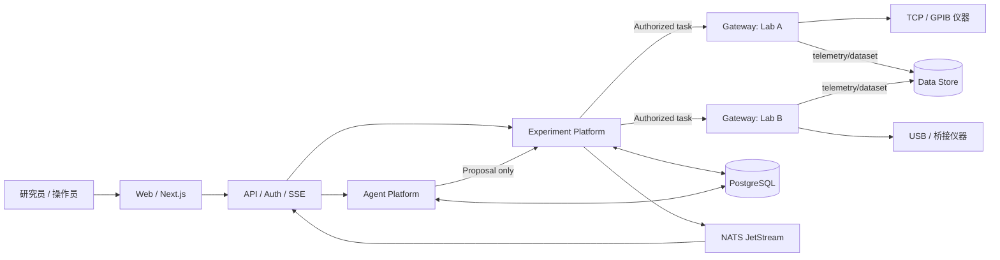

# 03 · 系统总体架构（Architecture）

> v3.1 开发基线；原始 v3.0 保存在根目录合订本与 ZIP。新增平台范围见第 17、18 章，契约规则见第 19 章，实施顺序以第 20 章为准。

## 1. 架构原则

- **控制平面与数据平面分离**：Agent 输出建议；调度器决定授权；Gateway 执行；数据另存。
- **单一状态权威**：实验任务/审批/租约的业务权威状态在 PostgreSQL；物理设备实际状态以设备读回/传感器为准，二者不得混淆。
- **无裸指令直达**：仅受约束的 capability / skill 可以产生写操作；原始 SCPI 仅供受控驱动层使用。
- **先模拟，再接线**：硬件上线阶段必须有双人评审及设备特定的安全矩阵。
- **模块化单体优先**：前期减少无必要的分布式一致性问题，Gateway 和高耗时 Agent Worker 单独部署。

## 2. 由九层到三个产品域

| 产品域 | 对应层 | 主要模块 |
|---|---|---|
| Product & Interaction | L1–L2 | Next.js、BFF/FastAPI、Auth、SSE、Audit UI |
| Agent Platform | L3–L4 | Agent Registry、Runtime、Tool/Skill Registry、Memory、Trace、Evaluation |
| Experiment Execution Platform | L5、L8–L9 | Workflow、Scheduler、Lease/Approval、Gateway、Safety Policy、Drivers |
| Shared Foundation | L6–L7 | PostgreSQL、dataset store、Device Registry、NATS、Schema、Observability |

## 3. 逻辑系统上下文

## 4. 部署容器（初期）

| 容器 | 部署位置 | 执行单元 | 权责边界 |
|---|---|---|---|
| `web` | 中央节点 | Next.js | 展示和交互，不存控制权威状态 |
| `api` | 中央节点 | FastAPI | 身份认证、输入校验、实验聚合 API、SSE |
| `agent-worker` | 中央节点 | Python + LangGraph | 只生成候选计划、分析、Proposal；工具策略强制隔离 |
| `experiment-engine` | 初期与 api 同进程/同仓库 | 确定性 Python 服务 | DAG、状态机、资源锁、审批、任务执行许可 |
| `postgres` | 中央持久化 | DB | 事务权威、outbox、审计、索引 |
| `event-bus` | 中央 | NATS JetStream | 可重放业务通知，不是物理命令权威 |
| `dataset-store` | 中央或站点本地+同步 | 文件/NAS/S3 等 | HDF5/Zarr、校验和和版本 |
| `gateway` | 近端仪器 PC | Python 服务 | 设备接入、状态轮询、受控技能、现场失联策略 |
| `hardware interlock` | 设备侧 | 独立控制器 | 不依赖上述软件 |

## 5. 运行路径与信任边界

### 5.1 一条写命令
`User → API/Auth → Approved Plan → Scheduler/resource lease → Signed/Authenticated CommandEnvelope → Gateway policy & fencing → validated driver call → hardware readback → task state reconciliation → event/UI`

### 5.2 Agent 提案
`Model response → JSON schema validation → Tool policy/guard → Proposal persisted → human/automatic policy arbitration → plan version created → Scheduler`。模型消息、外部文献或仪器注释均不得直接转化成写权限。

### 5.3 数据共享
`Gateway measurement → local durable staging → checksum → dataset store → manifest COMMITTED → dataset.committed.v1 event → analysis agents read authorized dataset`。非原子跨存储写通过 manifest 状态机实现最终一致性。

## 6. 两个状态系统不得混淆

- **LangGraph state**：消息、规划草案、工具调用结果、模型检查点；恢复一个 Agent 的思考过程。
- **Experiment engine state**：run/task/lease/approval/command/dataset；恢复一个物理实验的执行协调过程。

即使 LangGraph 检查点恢复到“准备再次调用工具”，也不得自动重复触发已经发往物理仪器的命令。所有副作用必须通过业务 `command_id`、设备读回和 `UNKNOWN` 对账界面处理。

## 7. 主要故障域

| 故障 | 仍能运行的部分 | 行为要求 |
|---|---|---|
| 浏览器断开 | 中央已获授权任务与近端扫描 | 前端重连获取状态和补偿事件 |
| LLM API 故障 | 已授权确定性工作流 | 不发起新规划，设备操作按任务边界运行 |
| NATS 故障 | 事务状态、Gateway 受约束运行 | outbox 待重发，不推断事件即命令成功 |
| 数据存储满 | 仪器安全控制 | 采集失败按设备策略结束；不能假装已保存 |
| Gateway 断网 | 本地看门狗/互锁/现场控制 | 执行约定失联策略、旧租约不可扩大 |
| 中央 DB 故障 | 已下发的有限边缘任务 | 不允许无限新任务；恢复后对账 |

## 8. 架构约束

- 常规 Web 控制与低延迟硬件同步分离；多设备亚毫秒同步要使用专用硬件触发/DAQ/同步时钟。
- 网关可托管不同连接方式，但任何物理设备在同一时间只有一个有效写所有者。
- PostgreSQL + NATS 的 outbox 提供“事件最终投递”，不保证物理动作 exactly-once。
- 作为接口先使用 REST/SSE；NATS 用于内部异步事件；Gateway 可选择 mTLS HTTP/gRPC。MCP 可为 Agent 暴露只读或受控高层 Tool，但不是绕过调度的命令通道。

## 9. 设计决策和取舍

查看 `15_ADR.md`。九层是**逻辑分层**，不是九个必须独立部署的进程。v3.1 采用根目录 `contracts/` 共享契约与 `src/alap/` Python 模块化后端；领域、应用、适配器、入口逐层添加，后续 `apps/web`、`infra`、Gateway 独立入口按需要落地。部署进程不等于代码包边界。

## 10. v3.1 依赖方向

Web/HTTP/Worker/Gateway 入口 → 应用用例 → 领域模型与端口；PostgreSQL、NATS、供应商 SDK、MCP 和驱动为外部适配器。领域层不依赖 FastAPI、LangGraph 或供应商 SDK。Agent Registry 关联 ModelProfile、SkillVersion、MCPToolBinding；用量与 trace 为横切服务。

第一阶段只安装契约与领域测试依赖，框架在对应实施层加入并锁版本。模型通过 API 接入，不要求本地加载模型权重。
