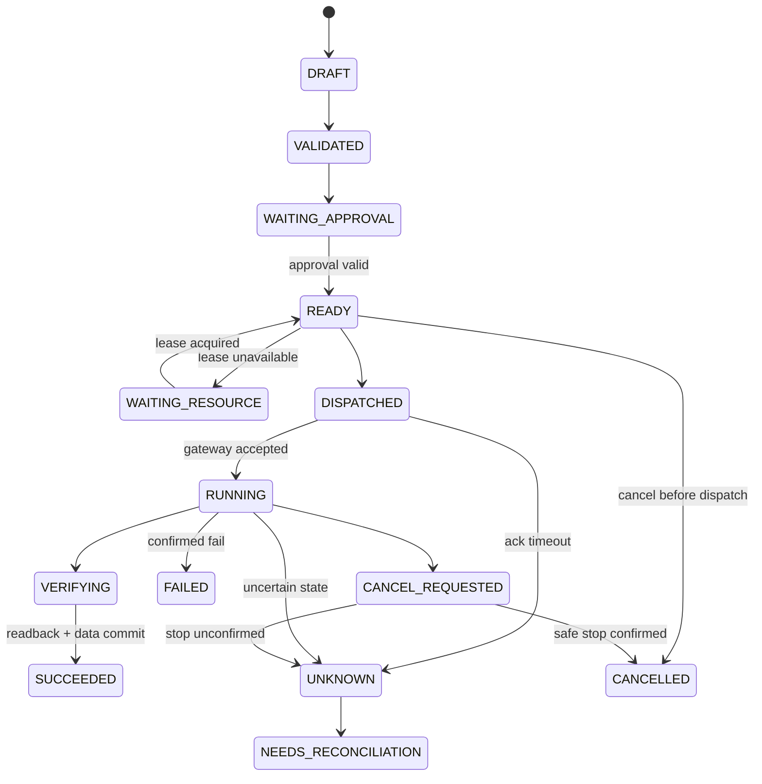

# 07 · Experiment Execution Platform：工作流、调度与资源锁

> v3.1 开发基线；原始 v3.0 保存在根目录合订本与 ZIP。新增平台范围见第 17、18 章，契约规则见第 19 章，实施顺序以第 20 章为准。

## 1. 职责边界

实验执行引擎是**确定性、可审计的状态机**，与 Agent Runtime 分离。它不接受自然语言作为直接硬件指令，不依赖模型在每个采样点做决策。职责：计划校验、DAG、审批门禁、资源租约、命令台账、事件 outbox、设备状态对账、人工干预。

## 2. 核心对象

`Experiment`（业务容器）；`PlanRevision`（不可变计划版本）；`Run`（一次执行）；`Task`（有输入/输出的工作节点）；`TaskAttempt`（同一任务的执行尝试）；`Command`（一条有物理副作用的请求）；`Approval`（限定版本和范围的许可）；`ResourceLease`（独占控制权）；`Dataset`（一次已标识的采集结果）。

## 3. Workflow DSL

当前可校验实例以 `contracts/examples/plan_proposal.json` 为准。Task 字段及条件语义见第 19 章；资源用 `resource_id/required_resources`，技能必须锁定 `skill_ref`，前置条件与成功判据为结构化对象。模拟参数不构成真机授权。

## 4. 执行生命周期概览（非完整实现状态表）

绝对不能将 HTTP 200、消息送达或设备“目标值已设定”等同于仪器完成动作。`SUCCEEDED` 需有明确技能级成功判定（读回、稳定窗口、采集与提交）。

## 5. Lease + Fencing + 单写者

- `resource_id` 物理设备唯一；一个时刻只有一个有效控制租约。
- `fencing_token` 单调增加，Gateway 持久化已见最大 token；小于该值的命令拒绝。
- 租约包含 `lease_id`, `holder_run_id`, `expires_at`, `policy_version`，执行器在**每个命令边界**校验。
- 分布式扫描不能因租约过期突然保持危险输出；近端固化失联/租约策略，在安全点终止或执行经过安全评审的有限步骤。
- 多资源领取固定全局排序；超过等待时间释放并重新排队，避免部分占有死锁。
- 设备 ID、Gateway ID、物理通道/端口映射须纳入唯一性校验，防止同一设备注册为两个名称逃避独占锁。

## 6. 幂等、超时、未知结果

**业务去重与物理副作用是两个问题。** NATS JetStream 消息可能重投；数据库唯一约束和 CommandLedger 能防止调度重复，但某次 SCPI 已被硬件执行却无回执时仍不可盲重试。

| Command 执行状态 | 可否自动重试 | 调度行为 |
|---|---|---|
| NOT_DISPATCHED | 可按策略 | 使用原 `command_id` 幂等出队 |
| REJECTED_BEFORE_EXECUTE | 修正后可新建命令 | 原命令不可重放 |
| ACCEPTED/RUNNING | 不能新发同动作 | 查询/等待设备与执行器状态 |
| SUCCEEDED | 禁止重做 | 直接读已有结果 |
| FAILED_CONFIRMED | 依据技能安全规程决定 | 新 Command ID + 新尝试 |
| UNKNOWN | **禁止盲重试** | 冻结后继任务→只读核对→必要时现场操作员介入 |

## 7. Approval 约束

审批绑定：`plan_hash`、`revision`、授权用户、设备集合、动作与参数 envelope、安全策略版本、有效期、审批原因。计划、设备清单、危险动作或安全策略版本改变会使批准失效。紧急本地联锁不依赖审批可随时生效；紧急安全动作使用厂商规定的专用通道。

## 8. Outbox 与事务一致性

在同一个 PostgreSQL 事务中写入 Task/Command 状态以及 `outbox_events`。后台发布器至少一次向 NATS 投递，收到 broker ack 后标记已发送；消费者使用 `event_id` 去重。**不宣称跨 DB、NATS 与硬件的物理 exactly-once**。对于重复/乱序事件，以 DB 当前任务版本或状态转换规则裁决。

## 9. Pause / Cancel / Resume / Takeover

- `PAUSE_REQUESTED`：停止发布新任务，现有任务到达可控安全点才 `PAUSED`。
- `CANCEL_REQUESTED`：请求边缘执行器安全终止，明确等待确认；无法确认转 `UNKNOWN`。
- `RESUME`：重新核实租约、审批有效期、设备真实状态、依赖前置条件，必要时创建新的 Run/TaskAttempt。
- `TAKEOVER`：现场操作员经双因素/审批（依据风险）接管；回收或废止旧租约，发行新 token，不能信任旧执行状态。

## 10. 测量稳定性与同步

稳定性使用实际传感器的窗口判据：`abs(measurement-target) <= tolerance` 且 `|slope| <= max_slope` 持续 `minimum_duration`，包括采样鲜度与总超时；具体容差由现场配置。跨设备精密同步须采用共享硬件触发、时钟或 DAQ；Event Bus 仅编排，不作为同步触发器。

## 11. 验收场景

两个并发实验申请同设备 → 只有一个租约生效；先获租约的任务完成/释放后另一任务可继续。测试网关在“执行命令后、返回 ACK 前”断网 → 任务 UNKNOWN，系统不得发送重复高风险动作。批准 Plan v2 后提交 v3 → 无审批就拒绝执行。NATS 多次重投 `dataset.committed.v1` → 只注册一个 Dataset、没有新扫描。
