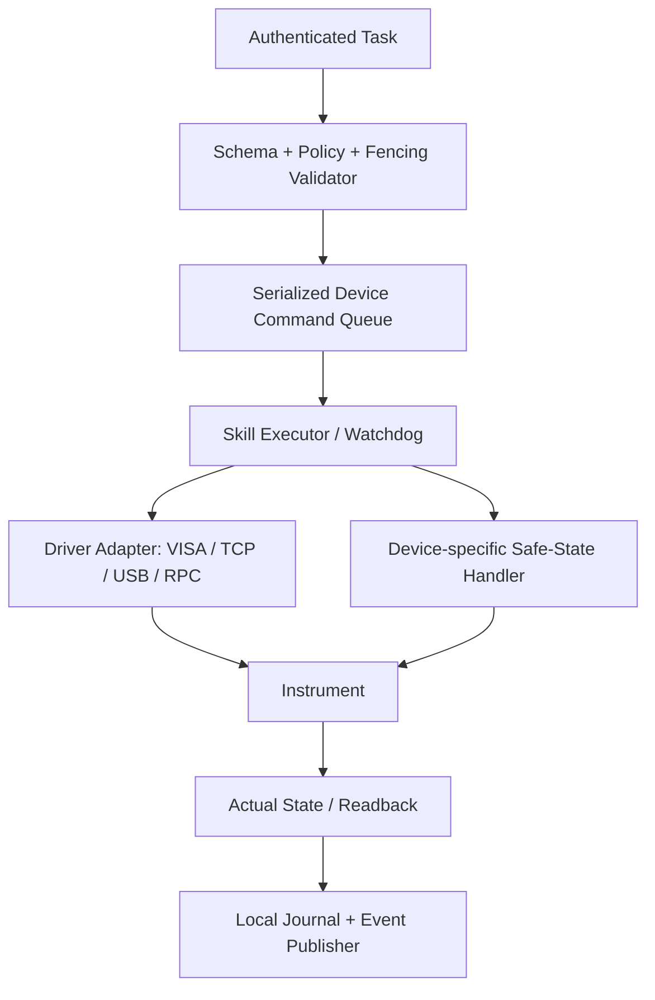

# 08 · 分布式 Instrument Gateway 与现有桥接兼容规范

> v3.1 开发基线；原始 v3.0 保存在根目录合订本与 ZIP。新增平台范围见第 17、18 章，契约规则见第 19 章，实施顺序以第 20 章为准。

## 1. 设计目标

将 TCP、GPIB、USB、RS232 和已有桥接程序统一抽象为**设备能力 + 状态 + 受控执行器**。Gateway 部署于仪器近端 PC，可以不部署 LLM。中央任务下发粗粒度测量，采样循环、限幅、超时和失联处置由近端确定性程序负责。

## 2. 兼容三类现有桥接

| 现状 | 方案 | 注意 |
|---|---|---|
| A：TCP 透明转发 `*IDN?` 等 | Gateway 封装 `RawTransportAdapter`，保留旧程序 | 仅白名单驱动调用，不允许 LLM 直接写 SCPI |
| B：桥接程序支持 RPC/API | Gateway 包装 `RpcAdapter`，映射动作、状态和错误 | 验证桥接服务是否已做本地限幅/回读 |
| C：已有本地扫描/数据采集程序 | Gateway 将其注册成 `SkillExecutor` | 必须验证其取消语义、超时、数据完整性和安全边界 |

禁止将桥接程序“能转发命令”等同于“已具备安全控制能力”。

## 3. Gateway 内部组件



### 标准接口（Python 伪代码）

```python
class InstrumentAdapter(Protocol):
    async def identify(self) -> InstrumentIdentity: ...
    async def read_state(self) -> ObservedInstrumentState: ...
    async def execute_skill(self, command: ValidatedCommand) -> SkillResult: ...
    async def request_safe_stop(self, command_id: str) -> StopReport: ...


class GatewayExecutor:
    async def accept(self, envelope: CommandEnvelope) -> Ack:
        # authenticate → schema → lease/fence → policy → idempotency ledger
        ...
```

`request_safe_stop` 的准确行为因设备而异；对磁体/低温系统可能不能简单切断电源，必须遵循设备规程。

## 4. Capability Manifest

每台仪器需注册：`instrument_id`、`gateway_id`、型号/序列号、驱动及固件版本、传输类型、读写能力、技能及参数 Schema、计量单位、支持的读回项、硬安全策略引用、更新版本及状态 TTL。见 `contracts/capability.schema.json`。新设备上线先只读发现，不得让发现结果自动授予写权限。

## 5. 结构化命令

关键字段：`command_id`、`experiment_id`、`run_id`、`task_id`、`instrument_id`、`lease_id`、`fencing_token`、`policy_version`、`skill_id`、`parameters`、`deadline_at`、`authorized_plan_hash`、`issued_at`。见 `contracts/command.schema.json`。

Gateway 需要：认证命令签发者、拒绝过期/错误设备/过低 fencing token、严格类型与单位验证、核对当前设备模式/仪器互锁、记录写前/写后实际状态、采集 `observed_at`。

## 6. 命令 ACK 分层

| 响应 | 含义 |
|---|---|
| `RECEIVED` | Gateway 已接收并排队（未证明硬件已执行） |
| `ACCEPTED` | 权限/能力/租约等通过，已取得设备执行排队权 |
| `RUNNING` | 本地执行器开始动作 |
| `SUCCEEDED` | 经技能定义的完成和读回验证，且数据完整提交（如适用） |
| `REJECTED` | 执行前拒绝，并给出原因 |
| `FAILED` | 已知失败并按既定策略结束 |
| `UNKNOWN` | 动作结果无法判断，需对账 |

## 7. 通信拓扑与隔离

- Gateway 主动连接中央服务/受认证代理（若实验室网络允许），减少开放入站端口；不同实验室 VLAN 经防火墙白名单访问。
- 中央到 Gateway 使用 mTLS 或等效的双向服务认证；设备直连口默认不对 Web/Agent 暴露。
- 近端维持持久命令 Journal 与缓存设备状态；断线后在授权边界内执行事先批准的失联策略。
- 大数据先近端持久化并原子提交校验和，再通过安全传输上传文件；不能只将数据存在 Gateway RAM。

## 8. 设备级安全状态机

`DISCONNECTED → DISCOVERING → READ_ONLY → READY → BUSY → VERIFYING → READY`；故障进入 `FAULT` 或 `INTERLOCKED`；异常执行未知进入 `NEEDS_ATTENTION`。设备离线不会自动恢复到 `READY`，需完成连接、实际状态及政策版本核对。

## 9. 故障动作矩阵（必须逐设备签署）

| 场景 | 默认软件策略 | 必须核实 |
|---|---|---|
| 网关与中央失联 | 不接受新命令；有限步骤或设备定义的安全结束 | 电源/磁体保场策略 |
| Gateway 崩溃 | 硬件互锁维持安全；重启前不自动恢复写 | 上电默认输出状态 |
| 设备读回与目标矛盾 | 拒绝后继依赖任务，标记 FAULT/UNKNOWN | 传感器准确性 |
| 写命令 ACK 丢失 | 不重发，查询本地 Journal 和实际状态 | 是否存在不可查询的副作用 |
| 采集空间不足 | 保留诊断、停止/结束采集并按设备策略处置 | 输出是否残留 |
| 租约过期/旧 token | 拒绝新控制；在安全点执行边缘策略 | 已在运行的扫描停止语义 |

## 10. 接入验收清单

设备标识不可冲突；只读自检通过；驱动已锁定版本；时钟偏差可观测；写权限需现场安全负责人授权；正常/失联/超时/重复命令/重启/人工接管均经模拟验证；每种物理设备至少完成一次有限、有人值守的现场试运行并签署风险评审。
