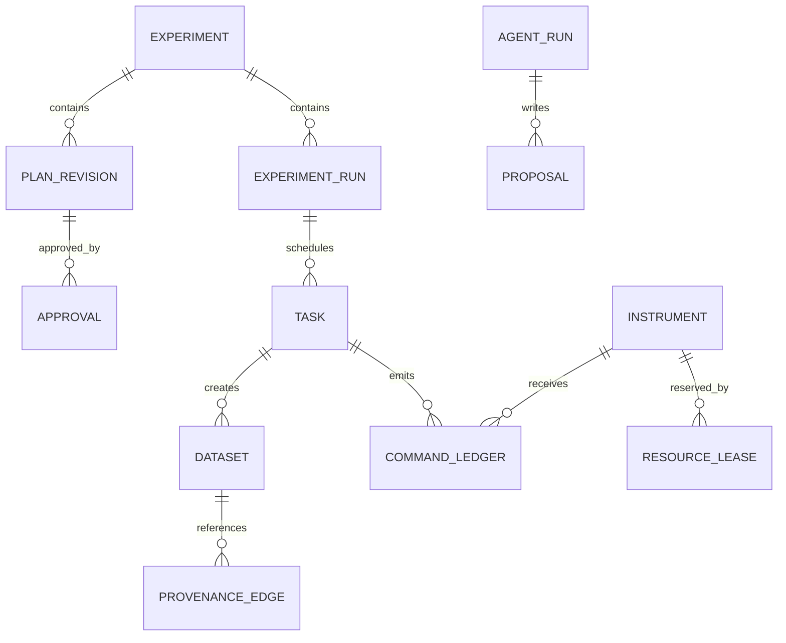

# 09 · 数据、事件与实验溯源架构

> v3.1 开发基线；原始 v3.0 保存在根目录合订本与 ZIP。新增平台范围见第 17、18 章，契约规则见第 19 章，实施顺序以第 20 章为准。

## 1. 数据分类

| 数据 | 权威存储 | 使用方式 |
|---|---|---|
| 实验、Run、Task、Command、Approval、Lease、Agent、审计 | PostgreSQL | 事务与权威状态 |
| 实际设备时间序列、IV 曲线、波形与大数组 | HDF5/Zarr / 对象存储 | 数据集 ID + Manifest 引用 |
| 异步领域事件、状态更新通知 | NATS JetStream | 至少一次投递，业务去重 |
| 文献和已批准的长期知识 | 版本化知识库/索引 | 引用与来源过滤 |
| 运行指标/Trace | OpenTelemetry + 日志存储 | 排障与性能分析 |

## 2. 初版关系模型



### 2.1 核心 DDL 片段（设计示意，可进一步用迁移管理）

```sql
CREATE TABLE experiments (
  id TEXT PRIMARY KEY,
  owner_id TEXT NOT NULL,
  title TEXT NOT NULL,
  state TEXT NOT NULL,
  revision BIGINT NOT NULL DEFAULT 0,
  created_at TIMESTAMPTZ NOT NULL DEFAULT now()
);
CREATE TABLE experiment_runs (
  id TEXT PRIMARY KEY,
  experiment_id TEXT NOT NULL REFERENCES experiments(id),
  plan_revision_id TEXT NOT NULL,
  state TEXT NOT NULL,
  created_at TIMESTAMPTZ NOT NULL DEFAULT now()
);
CREATE TABLE tasks (
  id TEXT PRIMARY KEY,
  run_id TEXT NOT NULL REFERENCES experiment_runs(id),
  state TEXT NOT NULL,
  state_version BIGINT NOT NULL DEFAULT 0,
  required_resource_ids JSONB NOT NULL DEFAULT '[]'::jsonb,
  updated_at TIMESTAMPTZ NOT NULL DEFAULT now()
);
CREATE TABLE command_ledger (
  command_id TEXT PRIMARY KEY,
  task_id TEXT NOT NULL REFERENCES tasks(id),
  instrument_id TEXT NOT NULL,
  lease_id TEXT NOT NULL,
  fencing_token BIGINT NOT NULL,
  payload_hash TEXT NOT NULL,
  state TEXT NOT NULL,
  observed_at TIMESTAMPTZ,
  updated_at TIMESTAMPTZ NOT NULL DEFAULT now()
);
CREATE TABLE datasets (
  dataset_id TEXT PRIMARY KEY,
  task_id TEXT NOT NULL REFERENCES tasks(id),
  manifest_uri TEXT NOT NULL,
  checksum_sha256 TEXT,
  state TEXT NOT NULL CHECK (state IN ('STAGING','VALIDATING','COMMITTED','CORRUPT')),
  acquired_from TIMESTAMPTZ,
  acquired_to TIMESTAMPTZ
);
CREATE TABLE outbox_events (
  event_id UUID PRIMARY KEY,
  aggregate_id TEXT NOT NULL,
  aggregate_seq BIGINT NOT NULL,
  experiment_id TEXT NOT NULL REFERENCES experiments(id),
  experiment_seq BIGINT NOT NULL,
  event_type TEXT NOT NULL,
  payload JSONB NOT NULL,
  published_at TIMESTAMPTZ,
  UNIQUE (aggregate_id, aggregate_seq),
  UNIQUE (experiment_id, experiment_seq)
);
```

**迁移前补齐的表**：`users`, `roles`, `instrument`, `gateways`, `plan_revisions`, `approvals`, `resource_leases`, `proposals`, `agent_runs`, `audit_events`, `provenance_edges`。对资源租约唯一性应使用事务锁/约束和版本检查，不只依赖应用内 mutex。

## 3. 实验数据 Manifest

完整、可验证实例见 `contracts/examples/dataset_manifest.json`；版本 2.0 要求逐设备的 policy_versions、capability_versions、采集窗口和 schema_version。公开接口与持久化 Manifest 共用结构，公开结果限定 COMMITTED。

`COMMITTED` 只有在文件 fsync/对象存储确认、校验和比对、元数据事务完成后才能发布；半成品不可给 Analysis Agent 当完整实验数据。

## 4. 时间、单位与数据质量

- 时间一律保存 UTC ISO 8601（带时区）和原始设备时钟来源；设备读数 `observed_at` 与中央收到时间 `received_at` 分开。
- 优先以 SI 规范值入库存储，展示层可选 mT、μA；所有参数含单位和允许范围；跨厂商转换显式。
- 传感器测量数据带 `quality`: `GOOD|STALE|UNCERTAIN|INVALID`；失联时不能保留“STABLE”而不说明数据过期。
- 对于多仪器时间对齐，记录时钟同步源、偏差估计和采样窗口，硬件触发的 timestamp 单独提供。

## 5. Domain Event 契约

事件 envelope 字段：`event_id`, `aggregate_id`, `aggregate_seq`, `experiment_seq`, `event_type`, `schema_version`, `occurred_at`, `producer`, `trace_id`, `experiment_id`, `payload`。完整 JSON Schema 在 `contracts/event.schema.json`。

典型事件：`experiment.run_created.v1`、`agent.proposal_created.v1`、`plan.approved.v1`、`task.started.v1`、`gateway.command_unknown.v1`、`dataset.committed.v1`、`device.status_changed.v1`、`task.reconciled.v1`。

消费规则：至少一次；按照 `event_id` 去重；不同 aggregate 无全局有序保证，按 `aggregate_seq` 检测乱序；Handler 幂等；业务数据库永远高于推送状态。JetStream 的 broker 层去重窗口**不能替代永久业务台账**。

## 6. 实验知识图 + 执行图

MVP 用关系数据库实现 ARTEX 类比的双图：
- **Knowledge/Asset 图**：`Experiment → Sample → Instrument → Dataset → Analysis`，描述“有什么数据/证据”。
- **Execution/Exploration 图**：`Proposal → PlanRevision → Run → Task → Command → Event → Dataset`，描述“如何得到数据”。

`provenance_edges(source_type,source_id,relation,target_type,target_id,created_at)` 记录有方向的血缘关系，未来再决定是否单独引入图数据库。分析结论至少绑定数据集、算法版本、参数、生成时间与 Agent/用户来源。

## 7. 存储、保留、导出与访问

MVP 每个 Experiment 明确 owner、访问主体、归档状态；删除按管理员策略执行并保留必要审计；数据保留期按实验室政策待定；数据导出附 Manifest 和哈希，防止只导出曲线却丢失实验条件。

实验事件持久游标及快照原子水位见第 19 章。aggregate_seq 不用作跨对象 SSE 游标。
